<div align="center">

# ⚛️ Quantum Computing Basics

### From Classical Machines to Quantum Thought

[]()
[]()
[]()
[]()
[]()

**A long-term, demystified reference for understanding the physics, math, and computation behind qubits.**

> *"Nature isn't classical, dammit, and if you want to make a simulation of nature, you'd better make it quantum mechanical."* — Richard Feynman, 1981

[📖 Read](#-table-of-contents) · [🧠 Mental Model](#-the-mental-model) · [⚡ Quick Start](#-quick-reference) · [🔐 Cryptography](#-cryptography--security)

</div>

---

## 📑 Table of Contents

| # | Section | What You'll Get |
|---|---------|-----------------|
| 1 | [The Story So Far](#-the-story-so-far) | Timeline from Babbage to Shor |
| 2 | [Classical Computing](#-classical-computing-the-deterministic-era) | The deterministic foundation |
| 3 | [Birth of Quantum Mechanics](#-birth-of-quantum-mechanics) | The new physical reality |
| 4 | [The Conceptual Bridge](#-the-conceptual-bridge) | When physics met computation |
| 5 | [Formalizing Quantum Computation](#-formalizing-quantum-computation) | Deutsch, Shor, Grover |
| 6 | [Why This Repo Exists](#-why-this-repository-exists) | The motivation |
| 7 | [Core Concepts](#-core-concepts) | Qubits, states, gates, circuits |
| 8 | [Mathematical Framework](#-mathematical-framework) | Bra-ket, vectors, Bloch sphere |
| 9 | [Quantum Operations](#-quantum-operations--dynamics) | Gates, interference, coherence |
| 10 | [Classical vs Quantum](#-classical-vs-quantum) | Side-by-side comparison |
| 11 | [Cryptography Impact](#-cryptography--security) | RSA, post-quantum |
| 12 | [NISQ Era](#-real-world-nisq-era) | Today's noisy reality |
| 13 | [Quick Reference](#-quick-reference) | Cheatsheet |

---

## 📜 The Story So Far

Quantum computing didn't appear overnight. It's the convergence of **two centuries** of breakthroughs in physics and computer science.

### 🕰️ Interactive Timeline

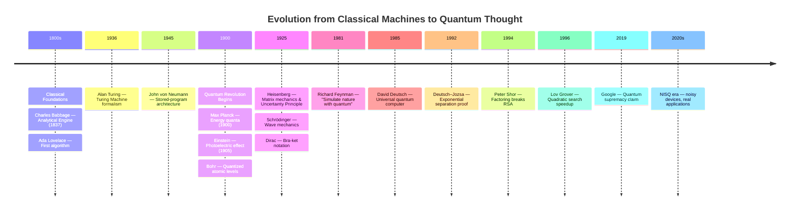

### 🎯 Two Parallel Revolutions

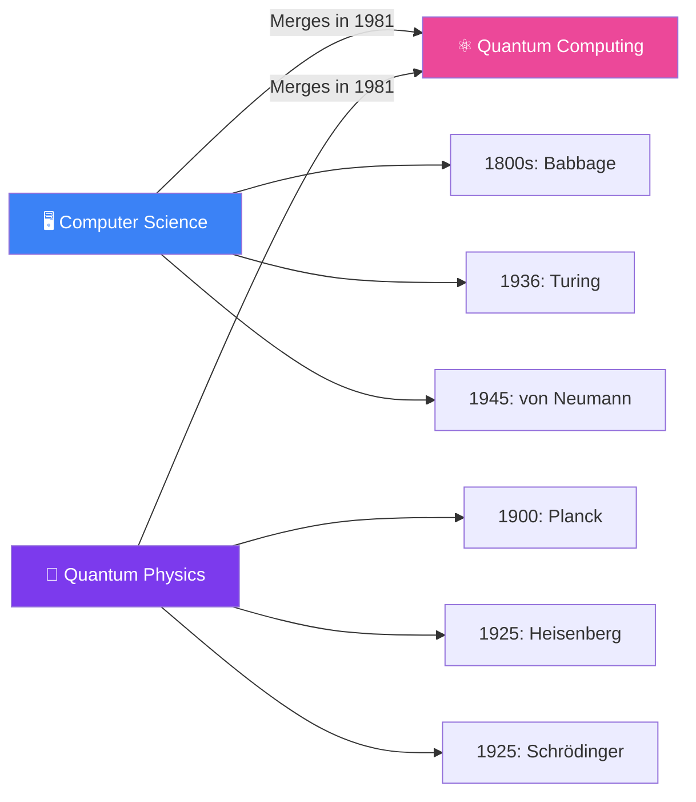

---

## 🖥️ Classical Computing: The Deterministic Era

The journey of computation began **long before silicon chips**.

### The Founding Pillars

<details>
<summary><b>🧮 Charles Babbage (1837) — The Analytical Engine</b></summary>

> Conceptualized the first **programmable computer** — punch cards, memory, a processor, output. It was never fully built in his lifetime, but every modern computer descends from its architecture.
</details>

<details>
<summary><b>🧠 Alan Turing (1936) — The Turing Machine</b></summary>

> Formalized computation as a mathematical object. Defined what it means for a problem to be **computable** — the boundary between "solvable" and "unsolvable" problems.
</details>

<details>
<summary><b>🏛️ John von Neumann (1945) — Stored-Program Architecture</b></summary>

> Programs and data live in the **same memory**. This simple idea is the blueprint of every CPU you've ever used.
</details>

### What Makes Classical Computing *Classical*

```python
classical_computer = {
    "state":      "binary (0 or 1)",      # No in-between
    "logic":      "Boolean (AND/OR/NOT)",  # Algebra of truth
    "behavior":   "deterministic",         # Same input → same output
    "operations": "irreversible",          # Information is lost on compute
}
```

### The Scaling Story — Moore's Law


For decades, progress meant **transistor miniaturization**, **faster clocks**, and **parallel hardware**. But as devices approached atomic scales, classical assumptions began to **break down** — and the door to quantum opened.

---

## ⚛️ Birth of Quantum Mechanics: A New Physical Reality

At the start of the 20th century, physics encountered phenomena that classical theories simply **could not explain**.

### 🧪 The Pioneers

| Year | Scientist | Contribution | Why It Matters |
|------|-----------|--------------|----------------|
| **1900** | 🟢 **Max Planck** | Energy quanta | Birth of quantum theory — energy comes in discrete packets |
| **1905** | 🔵 **Albert Einstein** | Photoelectric effect | Light behaves as **particles** (photons), not just waves |
| **1913** | 🟣 **Niels Bohr** | Quantized atomic levels | Electrons orbit in fixed energy shells |
| **1925** | 🟠 **Werner Heisenberg** | Matrix mechanics + Uncertainty Principle | You **cannot** know position and momentum perfectly at the same time |
| **1926** | 🔴 **Erwin Schrödinger** | Wave mechanics | The famous equation that evolves quantum states over time |
| **1928** | 🟡 **Paul Dirac** | Bra-ket notation | The math we still use to write qubits today |

### The Three Strange Truths of Quantum Mechanics

> 🌀 **Probabilistic** — Nature speaks in probabilities, not certainties
>
> 🎲 **Non-deterministic** — Identical setups can produce different outcomes
>
> ➗ **Linear** — Governed by linear algebra and complex amplitudes

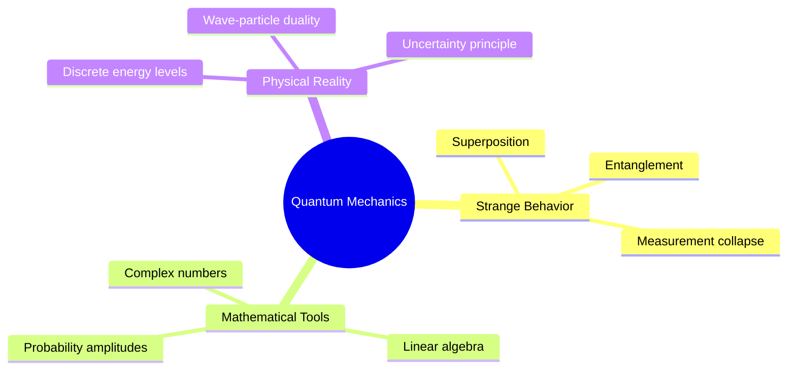

---

## 🌉 The Conceptual Bridge: Physics Meets Computation

For decades, **quantum mechanics** and **computer science** evolved on parallel tracks. The connection emerged from a single, brilliant question:

> 💭 *"If nature itself computes quantum mechanically, **why are we simulating it with classical machines?**"*

### 🎤 Richard Feynman (1981)

> **The quote that started it all:**

> *"Nature isn't classical, dammit, and if you want to make a simulation of nature, you'd better make it quantum mechanical."*

Feynman proposed that:
- ❌ Classical computers **cannot** efficiently simulate quantum systems
- ✅ **Quantum computers** are the natural solution

This single insight marked the **conceptual birth** of quantum computing.

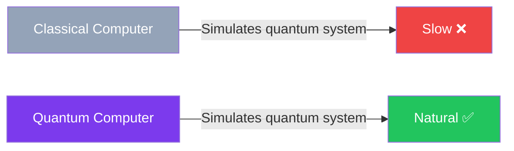

---

## 🔬 Formalizing Quantum Computation

Once the question was asked, the field exploded. Three milestones transformed quantum computing from **theory** into **strategy**.

### 🏆 The Big Three

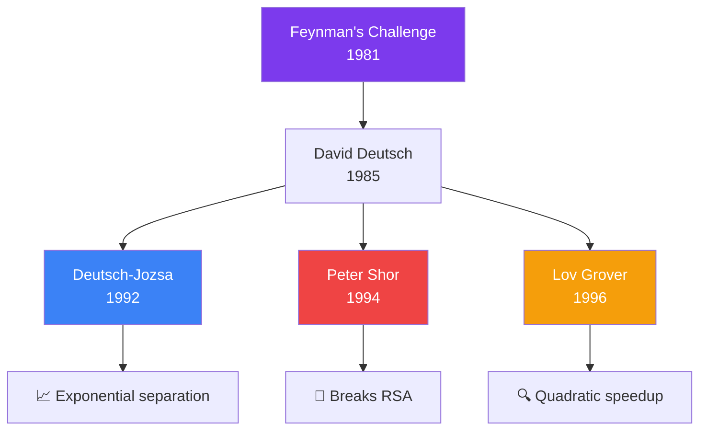

### 📋 The Landmark Papers

| Year | Scientist | Result | Impact |
|------|-----------|--------|--------|
| **1985** | 🟣 **David Deutsch** | Universal quantum computer | Extended the Church–Turing thesis into the quantum domain |
| **1992** | 🟢 **Deutsch & Jozsa** | First exponential separation | Proved quantum can outperform classical on a specific problem |
| **1994** | 🔴 **Peter Shor** | Factoring algorithm | **Breaks RSA encryption** in polynomial time — strategic earthquake |
| **1996** | 🟠 **Lov Grover** | Search algorithm | Quadratic speedup for unstructured search problems |

### 🔐 Why Shor's Algorithm Changed Everything

```python
# Conceptual comparison (NOT real code)
def factor_number(n):
    if using_classical_shor:
        # Sub-exponential but still slow
        return trial_division(n)           # ❌ exponential time

    if using_quantum_shor:
        return quantum_period_finding(n)  # ✅ polynomial time

# Implication: every RSA key in the world becomes breakable
#   once a large-enough quantum computer exists.
```

> ⚠️ **Strategic impact:** This single result turned quantum computing from a curiosity into a **national security priority**.

---

## 🎯 Why This Repository Exists

### The Honest Truth

> 🧠 *Quantum computing is often presented as mysterious or magical. In reality, it is built upon:*
> - **Linear algebra**
> - **Probability theory**
> - **Quantum mechanics**
> - **Careful mathematical abstraction**

### The Mission

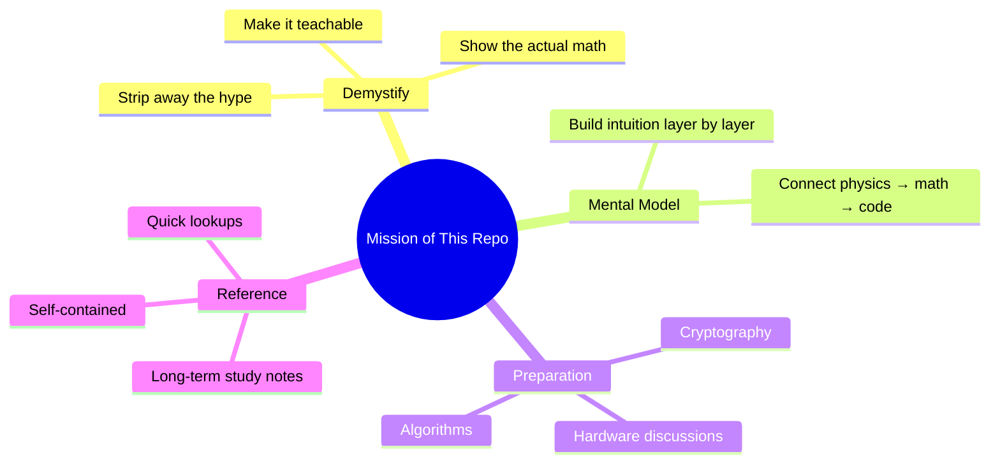

### The Core Belief

> 🚫 **You can't "code" quantum algorithms effectively until you understand the math and physics behind them.**

This repo is the bridge between *"quantum is cool"* and *"I can actually reason about a quantum circuit."*

---

## 🧬 Core Concepts

### Building Blocks at a Glance

| Concept | Definition | One-Line Intuition |
|---------|-----------|-------------------|
| **Quantum Mechanics** | Physics at atomic/subatomic scales | The rulebook for very small things |
| **Quantum (Quanta)** | Smallest indivisible unit of a physical property | Energy comes in packets, not continuous flow |
| **Qubit** | Quantum analogue of a classical bit | A coin spinning in the air — heads, tails, **or both** |
| **Superposition** | A qubit existing in multiple states at once | Linear combination of `\|0⟩` and `\|1⟩` |
| **Measurement** | Forcing a qubit to pick a definite value | The spinning coin lands |
| **State Collapse** | The qubit loses its superposition on measurement | Once you look, the magic is gone |

### 🪙 The Qubit — Spinning Coin Analogy

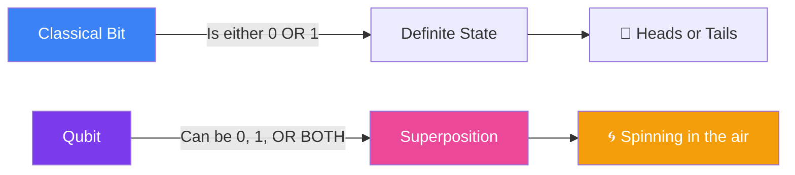

> 💡 **Key insight:** A qubit isn't "unknown" — it's genuinely **in both states at once** until measured. The mathematics captures this with probability amplitudes.

### 📐 Mathematical Representation

A qubit is represented as a **state vector** in a 2D complex vector space:

$$|\psi\rangle = \alpha|0\rangle + \beta|1\rangle$$

Where:
- `|ψ⟩` — the quantum state (read as "ket psi")
- `α`, `β` — **probability amplitudes** (complex numbers)
- `|α|² + |β|² = 1` — normalization (probabilities sum to 1)
- `|α|²` — probability of measuring `|0⟩`
- `|β|²` — probability of measuring `|1⟩`

```python
import numpy as np

# A qubit in equal superposition
alpha = 1 / np.sqrt(2)
beta  = 1 / np.sqrt(2)

qubit_state = np.array([alpha, beta])   # |ψ⟩ = (1/√2)|0⟩ + (1/√2)|1⟩
# Measuring this state gives |0⟩ or |1⟩ with 50/50 probability.
```

---

## 🧮 Mathematical Framework

Quantum computing is **mathematics-heavy by necessity**. This section builds comfort with the universal tools.

### 📚 The Toolkit

| Tool | Symbol / Notation | What It Does |
|------|-------------------|--------------|
| **Basis States** | `\|0⟩`, `\|1⟩` | The "north and south" of qubit space |
| **Kets** | `\|ψ⟩` | A column vector representing a state |
| **Bras** | `⟨ψ\|` | The complex-conjugate row vector |
| **Inner Product** | `⟨φ\|ψ⟩` | A complex number — the "overlap" between states |
| **Outer Product** | `\|φ⟩⟨ψ\|` | An operator (matrix) |
| **State Vector** | `ψ ∈ ℂ²` | A point in complex 2D space |
| **Bloch Sphere** | 3D unit sphere | Geometric picture of any pure qubit state |

### 🔣 Bra-Ket Notation — The Quantum Shorthand

$$\text{Ket: } |\psi\rangle = \begin{pmatrix} \alpha \\ \beta \end{pmatrix} \quad\quad \text{Bra: } \langle\psi| = \begin{pmatrix} \alpha^* & \beta^* \end{pmatrix}$$

```python
# A few canonical states you'll see everywhere
zero  = np.array([1, 0])                # |0⟩
one   = np.array([0, 1])                # |1⟩
plus  = np.array([1, 1]) / np.sqrt(2)   # |+⟩ = (|0⟩ + |1⟩)/√2
minus = np.array([1, -1]) / np.sqrt(2)  # |-⟩ = (|0⟩ - |1⟩)/√2
```

### 🌐 The Bloch Sphere

The Bloch sphere is the **geometric picture** of a single qubit's pure state.

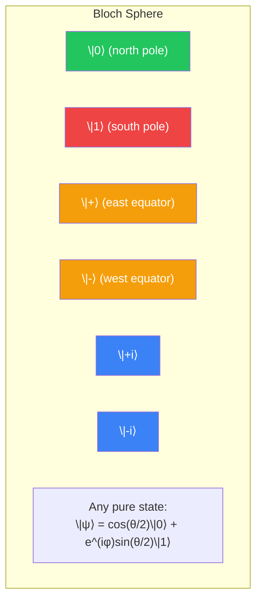

```
                    |0⟩  ↑  North pole
                      •──•──•
                    /  •     •  \
                   /  /  •    \  \
                  /  /  |ψ⟩    \  \
                 /  /     •      \  \
                |  /  θ ↙        \  |
                | /               \ |
                |/                 \|
       |+⟩ ─── • ──────────────── • ─── |+⟩
                |\                 /|
                | \               / |
                |  \             /  |
                 \  \           /  /
                  \  \         /  /
                   \  \       /  /
                    \  \     /  /
                      •──•──•
                    |1⟩  ↓  South pole
```

**Reading the sphere:**
- `θ` (polar angle) — controls the **probability mix** of `|0⟩` vs `|1⟩`
- `φ` (azimuthal angle) — controls the **relative phase**
- The surface = all **pure** states
- The interior = **mixed** states (decohered, not pure)

---

## ⚙️ Quantum Operations & Dynamics

### 🚪 Quantum Gates

| Gate | Classical Equivalent | Reversible? | Effect |
|------|---------------------|-------------|--------|
| **X (NOT)** | NOT | ✅ | Flips `|0⟩ ↔ \|1⟩` |
| **H (Hadamard)** | ❌ no analog | ✅ | Creates superposition |
| **Z** | ❌ no analog | ✅ | Flips phase of `|1⟩` |
| **CNOT** | XOR | ✅ | 2-qubit controlled flip |
| **Toffoli** | AND-NOT | ✅ | 3-qubit universal gate |

> 🔑 **Key difference:** All quantum gates are **reversible** (unitary). They rotate the state vector on the Bloch sphere without losing information.

### 🔧 A Simple Circuit

```python
from qiskit import QuantumCircuit

# Build: |0⟩ → H → Measure
qc = QuantumCircuit(1, 1)
qc.h(0)                  # Apply Hadamard → superposition
qc.measure(0, 0)         # Measure to classical bit

print(qc.draw())
```

```
     ┌───┐┌─┐
q_0: ┤ H ├┤M├
     └───┘└╥┘
c: 1/══════╩═
           0
```

> Running this circuit ~1000 times gives **roughly 50% |0⟩ and 50% |1⟩** — empirical proof of superposition.

### 🌊 Interference — The Secret Sauce

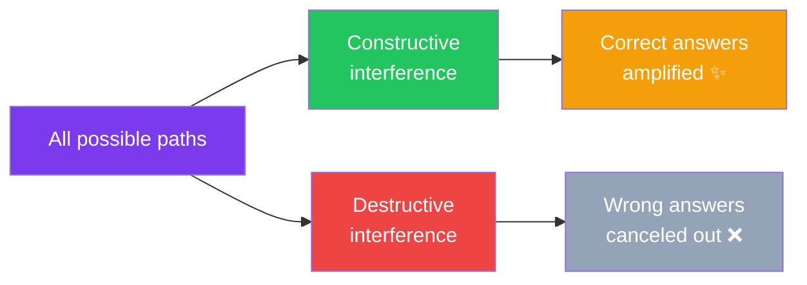

> **This is how quantum algorithms work:** they don't "try every answer" — they engineer **interference** so the right answer amplifies and the wrong answers cancel.

### ⏱️ Coherence vs Decoherence

| Property | What It Means | Why It Matters |
|----------|---------------|----------------|
| **Coherence** | Qubit maintains its quantum state | Required for any useful computation |
| **Decoherence** | Environmental noise corrupts the state | **The #1 enemy** of quantum computers |


> 🧊 Quantum computers need to be **colder than outer space** (~15 millikelvin) to fight decoherence.

---

## ⚖️ Classical vs Quantum

The fundamental differences in one view:

| Aspect | 🖥️ Classical | ⚛️ Quantum |
|--------|--------------|-----------|
| **Information unit** | Bit (0 or 1) | Qubit (0, 1, or both) |
| **State** | Definite | Superposition until measured |
| **Computation** | Deterministic | Probabilistic |
| **Parallelism** | Explicit (multi-core) | Intrinsic (quantum parallelism) |
| **Operations** | Mostly irreversible | Always reversible (unitary) |
| **Scalability** | Hardware-bound | Physics-bound |
| **Error model** | Bit-flips, soft errors | Bit-flips + phase-flips + decoherence |
| **Security impact** | RSA-safe (today) | **RSA-breaking** (with enough qubits) |
| **Best at** | Everything practical | Specific structured problems |
| **Example strengths** | Word processing, databases | Factoring, simulation, optimization |

### 🚀 Three Concepts You Must Know

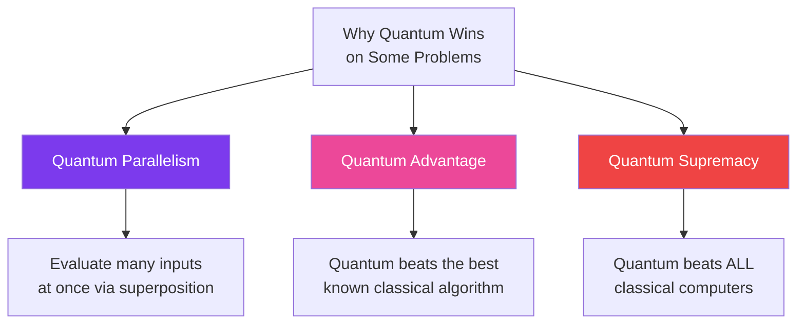

| Term | Definition | Example |
|------|-----------|---------|
| **Quantum Parallelism** | A single quantum operation acts on many states at once | Hadamard on 1 qubit creates 2 states |
| **Quantum Advantage** | Quantum beats the **best known classical** algorithm | Shor's algorithm vs. GNFS |
| **Quantum Supremacy** | Quantum beats **all** classical computers at a task | Google's 2019 sampling experiment |

---

## 🔐 Cryptography & Security

Quantum computing has **direct, strategic implications** for cybersecurity.

### 🛡️ The Threat Landscape

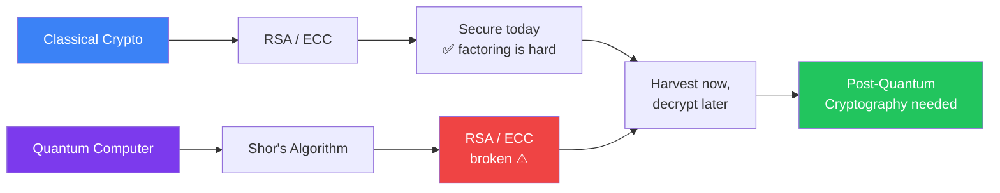

### 📋 The Story

| Layer | What It Is | Quantum Status |
|-------|-----------|----------------|
| **RSA** | Public-key crypto based on factoring | ❌ Broken by Shor (1994) |
| **ECC** | Public-key crypto based on elliptic curves | ❌ Also broken by Shor |
| **Symmetric (AES)** | Same key both sides | ⚠️ Grover halves the key strength (use 256-bit) |
| **Hashing (SHA-256)** | One-way functions | ⚠️ Grover gives quadratic speedup only |
| **Post-Quantum Crypto** | Lattice, code-based, hash-based schemes | ✅ Active research & standardization (NIST PQC) |

### 🔑 Key Takeaway

> ⏰ **"Harvest now, decrypt later"** — adversaries are recording encrypted traffic **today**, waiting for the quantum hardware to break it. The transition to post-quantum cryptography is **already urgent**.

---

## 🏗️ Real-World Quantum Computing (NISQ Era)

Quantum computers today are **not perfect**. The current era is called **NISQ**:

> **N**oisy **I**ntermediate-**S**cale **Q**uantum

### 🧊 The Reality

| Property | What It Means |
|----------|---------------|
| **Noisy** | Qubits decohere quickly; gates have ~99% fidelity (not 100%) |
| **Intermediate-Scale** | 50–1000 physical qubits (we need millions for fault-tolerant) |
| **No error correction** | Most systems can't yet run full quantum error correction |

### ⚠️ Why This Is Hard

```python
# The brutal numbers
target_operations = 10**15          # A useful algorithm might need this many gates
current_error_rate = 0.001          # 99.9% fidelity per gate
1 - current_error_rate**target_operations   # ≈ 1.0 — guaranteed garbage
```

> 📉 **The math is unforgiving:** even 99.9% fidelity means a deep algorithm will almost certainly fail. **Quantum error correction** is essential — and that's where the engineering goes next.

### 🔬 Hardware Paradigms

| Platform | Used By | Strengths | Weaknesses |
|----------|---------|-----------|-----------|
| **Superconducting Qubits** | IBM, Google | Fast gates, scalable fabrication | Need millikelvin cooling |
| **Trapped Ion Qubits** | IonQ, Quantinuum | Very high fidelity, long coherence | Slower gate operations |
| **Photonic Qubits** | Xanadu, PsiQuantum | Room temperature, networking | Probabilistic gates |
| **Neutral Atoms** | QuEra, Pasqal | Highly scalable arrays | Newer, less mature |
| **Topological** | Microsoft (Majorana) | Theoretically noise-resistant | Still experimental |

---

## ⚡ Quick Reference

### 🧠 Mental-Model Cheatsheet

| Question | Quick Answer |
|----------|--------------|
| What is a qubit? | A 2-level quantum system: `α\|0⟩ + β\|1⟩` |
| Why superposition? | Quantum objects exist in multiple states until measured |
| Why interference? | Algorithms engineer amplitudes to amplify correct answers |
| Why fragile? | Decoherence — environment constantly measures your qubit |
| Why powerful? | Quantum parallelism + interference = exponential structure exploited |
| Why probabilistic? | Measurement gives one outcome, weighted by `\|amplitude\|²` |

### 📐 Formulas to Remember

$$|\psi\rangle = \alpha|0\rangle + \beta|1\rangle \quad\quad |\alpha|^2 + |\beta|^2 = 1$$

$$\text{Born rule: } P(\text{outcome } i) = |\langle i|\psi\rangle|^2$$

$$\text{Single-qubit state on Bloch sphere: } |\psi\rangle = \cos\tfrac{\theta}{2}|0\rangle + e^{i\phi}\sin\tfrac{\theta}{2}|1\rangle$$

### 🐍 Minimal Qiskit Example

```python
from qiskit import QuantumCircuit
from qiskit.quantum_info import Statevector

# Create a Bell state (maximally entangled pair)
qc = QuantumCircuit(2)
qc.h(0)           # Superposition on qubit 0
qc.cx(0, 1)       # Entangle qubit 1 with qubit 0
# Result: (|00⟩ + |11⟩) / √2

print(qc.draw())
print("Statevector:", Statevector(qc).data)
```

```
     ┌───┐     
q_0: ┤ H ├──■──
     └───┘┌─┴─┐
q_1: ─────┤ X ├
          └───┘
```

### 📚 Suggested Reading Order


---

## 🗺️ What's Next?

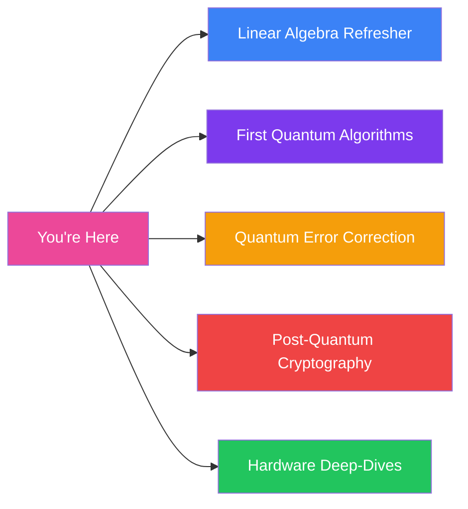

---

## 📚 References & Further Reading

- 📖 Nielsen & Chuang — *Quantum Computation and Quantum Information* (the standard textbook)
- 🎓 [IBM Quantum Learning](https://learning.quantum.ibm.com)
- 🐍 [Qiskit Textbook](https://qiskit.org/textbook)
- 📺 Various MIT OCW quantum computing lectures
- 📄 Original papers: Deutsch (1985), Deutsch–Jozsa (1992), Shor (1994), Grover (1996)

---

<div align="center">

### ⚛️ Built with curiosity, not just with code ⚛️

*If this helped you build a quantum mental model, drop a ⭐ — it keeps the notes growing.*

**Made while learning. Updated as understanding deepens.**

</div>
